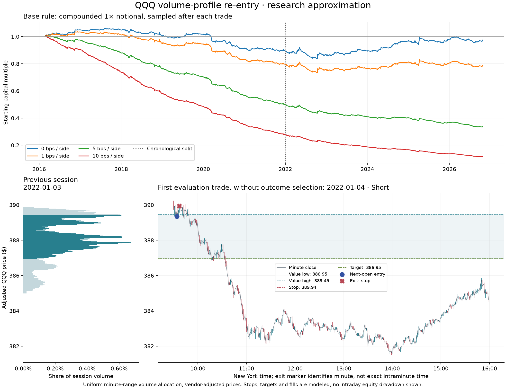

# QQQ volume-profile re-entry experiment — October 28, 2026

**This mechanical version does not demonstrate a useful trading edge.** Across
1,063 trades, average return is −0.17 basis points before costs and −10.17 basis
points at 5 bps per side. The far edge is eventually touched in 43.74% of trades,
but only 24.08% reach it before the chosen stop. All five sensitivity checks also
lose after costs. These findings concern this QQQ approximation and these rules;
they do not establish that every use of volume profiles fails.



## Question and fixed experiment

Does opening outside the previous regular session's 70% volume value area,
then closing back inside, offer a useful intraday trade toward the opposite edge?
The source is [Trading Notes, 26:00–27:43](https://www.youtube.com/watch?v=Nm5wdUvy0to&t=1560).
This tests the video's session re-entry idea, not its discretionary anchored-profile,
node-selection, candle-pattern or order-flow claims.

The following choices were fixed before running this experiment:

- Use the cached QQQ SIP one-minute regular-session archive, February 23, 2016
  through October 23, 2026. No new data download or live orders.
- Build a separate profile from each completed session. Divide its low-to-high
  range into 400 equal-price bins. Distribute each minute's volume uniformly
  across its low-to-high range in proportion to bin overlap. A zero-range
  candle contributes all volume to its single bin. This preserves volume but
  approximates its distribution: OHLCV does not reveal actual trades at each price.
- Begin the contiguous value area at the highest-volume bin, expanding toward
  the larger neighboring bin until at least 70% of session volume is included.
  Deterministic tie rules belong in the runner and saved results.
- If the next session opens below the value-area low, consider a long; above
  the value-area high, a short. Otherwise take no trade.
- Require one completed minute candle to close strictly inside yesterday's
  value area. Enter at the next observed minute's open, at most once per session.
  Skip an entry already through its stop or target; do not retry later.
- Target the opposite value-area edge. Stop beyond the entry-side edge by 10%
  of yesterday's full high-to-low range. These stop and acceptance definitions
  are explicit research assumptions where the video leaves choices open.
- Exit any remaining position at the last minute bar's open. Do not enter at
  that open. Stop gaps fill at the worse observed open; favorable target gaps
  receive only the target price. If both levels occur in one minute, stop wins.
- Test 0, 1, 5 and 10 basis points per side, with adverse entry/exit prices.
  Returns describe fractional, unlevered 1× notional exposure. They do not
  reconstruct a broker account, borrow availability, market impact or taxes.
- Compare the same entries held until the final-minute open. This matched
  baseline tests whether the profile stop/target adds value beyond entry timing.
- Report before-2022 discovery and 2022-onward chronological evaluation
  separately. Both periods have appeared in earlier research; neither is a
  pristine unseen holdout. Do not select a winner and relabel it a prior hypothesis.

Five one-at-a-time sensitivity checks change only the number of bins to 100 or
200, require two consecutive inside closes, concentrate each minute's volume at
its typical price `(high + low + close) / 3`, or widen the stop buffer to 25%.
These checks assess dependence on assumptions; they are not an optimization grid.

## Results

One basis point is 0.01%. Costs are assumptions, not measured historical spreads.
Every row below uses the same 1,063 entries and raw exits.

| Cost per side | Mean trade return | Profitable trades | Compounded return | Sampled maximum drawdown |
|---|---:|---:|---:|---:|
| 0 bps | −0.17 bps | 29.07% | −2.53% | 21.12% |
| 1 bp | −2.17 bps | 28.88% | −21.20% | 29.05% |
| 5 bps | −10.17 bps | 27.00% | −66.34% | 66.91% |
| 10 bps | −20.17 bps | 21.83% | −88.39% | 88.54% |

Compounding assumes each trade uses 1× current equity in fractional adjusted-price
notional. No leverage or overnight position is taken. Drawdown uses realized
session-end equity; it does not measure the worst unrealized intraday loss.
Profit factor at 5 bps per side is 0.50. No same-minute stop/target ambiguity occurs
in this base sample, although the simulator and tests explicitly handle it.

### Does price cross the value area?

Of 2,683 sessions with a previous profile, 907 open inside the value area, 709 open
outside but never produce the required acceptance, and four produce a signal too
late to enter. The remaining 1,063 yield trades:

- 256 reach the opposite edge before the stop: **24.08%**.
- 741 exit at the stop and 66 at the scheduled session-end open.
- 465 eventually touch the opposite edge by the session-end exit horizon,
  **ignoring stops: 43.74%**. This count starts at actual entry and excludes the
  final minute's high/low; only its open is observed before scheduled liquidation.
- 209 stopped-out trades later reach the target. A chart showing only the final
  move would conceal these stop-outs. Eventual target touches are a descriptive
  diagnostic, not additional profitable trades or permission to ignore risk.

### Chronological check

| Period | Trades | Gross mean | Mean at 5 bps/side | Target before stop | Eventual touch ignoring stop |
|---|---:|---:|---:|---:|---:|
| Before 2022 | 583 | −1.86 bps | −11.86 bps | 22.13% | 41.34% |
| 2022 onward | 480 | +1.88 bps | −8.12 bps | 26.46% | 46.67% |

The later period has a small gross improvement that disappears even at 1 bp per
side (−0.12 bps/trade). At 5 bps per side every individual calendar year's mean
is negative, including the partial 2016 and 2026 years. No future window was
reserved afresh for this study, and the sensitivity results were inspected.

### Do the profile exits add value?

Holding the exact same accepted entries until session end, without the profile
stop/target, averages **+2.78 bps gross** and **−7.22 bps net** at 5 bps per side.
The tested profile exits therefore reduce the observed mean by about **2.95 bps**.
Both alternatives lose after that cost assumption. This is a paired descriptive
comparison, not a significance test or proof that unrestricted holding is safer.

Direction also matters: longs average −4.03 bps gross (433 trades), shorts
+2.48 bps gross (630 trades). At 5 bps per side they average −14.02 and −7.52 bps,
respectively. The short subset retains +0.48 bps at 1 bp per side, a small
retrospective result dependent on an unverified cost assumption; it was not a
separately reserved hypothesis.

### Sensitivity without choosing a winner

Only the stated setting changes in each row. All other settings remain at base.

| Setting | Trades | Gross mean | Mean at 5 bps/side | Later-period mean at 5 bps/side |
|---|---:|---:|---:|---:|
| Base: 400 bins, uniform volume | 1,063 | −0.17 bps | −10.17 bps | −8.12 bps |
| 100 bins | 1,052 | −0.26 bps | −10.25 bps | −8.60 bps |
| 200 bins | 1,057 | −0.51 bps | −10.51 bps | −8.72 bps |
| Two consecutive inside closes | 1,022 | −0.54 bps | −10.53 bps | −9.11 bps |
| Volume at minute typical price | 988 | −0.25 bps | −10.25 bps | −6.56 bps |
| Stop buffer 25% of prior range | 1,063 | −0.80 bps | −10.80 bps | −6.68 bps |

The wider stop increases target-before-stop frequency to 33.30%, while worsening
the overall gross and net mean. A larger hit rate alone is not evidence of a
better strategy.

## How an actual trade works

The chart selects the first evaluation-period trade, **January 4, 2022**, without
selecting its outcome. The January 3 profile gives value-area low **386.9540** and
high **389.4458**. January 4 opens above that area, then closes back inside.

At **09:34 New York time**, the next minute opens at **389.35**, triggering a short.
Its opposite-edge target is **386.9540** and its stop **389.9368**, 10% of the
previous full-session range above the value-area high. The **09:37** minute hits
the stop: **−15.07 bps gross**, or **−25.09 bps** at 5 bps per side. The exact
intraminute execution time is unknown. Price subsequently falls through the
target. Holding that same short until the scheduled 15:59 open would instead
yield +102.09 bps after those costs. This example illustrates why eventual
direction and an executable trade result are different observations.

## Data identity and limitations

- Archive: `runs/qqq-1m-20160223-20261023`; **1,042,924 bars**, **2,684 sessions**.
- Feed SIP; regular sessions; one-minute bar-open timestamps; fully adjusted
  vendor research prices. No fabricated candles or unknown missing intervals.
- **56 verified whole-minute halt slots** are excluded in the source coverage.
  Execution resumes at the next observed open; minute data do not establish the
  exact intraminute reopening or execution time.
- CSV SHA-256: `551fd5feed7c8b230d90c4f36095a802ab095eacaa7709f1908b232dc6effe93`.
- Archive data identity: `2742c43e3d4fa50069447db85b71ae233d837c4dc40bbe048958d95342ddce31`.

The runner checks the archive's CSV, manifest and coverage hashes against its
provenance; validates QQQ/one-minute/regular-session settings, bar ordering and
OHLCV; and matches session counts to coverage. It relies on that checksum-bound
calendar coverage report rather than rebuilding the exchange calendar itself.

Minute OHLCV does not reveal volume at each traded price, bid/ask aggression,
order-book depth, queue position or fill availability. Price buckets and a greedy
contiguous value-area algorithm need not reproduce TradingView's output. Highest
volume ties select the lower-price bin; neighboring-volume ties expand downward.
Seventy percent is a volume share, not a normal-distribution confidence interval.

No real spread series, participation constraint, market impact, latency, separate
fees, cash yield, short locate/borrow expense, taxes or financing are modeled.
Fully adjusted prices may change with later vendor adjustments and do not model
dividend cash or historical share transformations. This is a standalone research
runner, not a production broker/strategy integration.

## Reproduce and validate

From the repository root, with the cached archive present:

```sh
node research/qqq-volume-profile.cjs --output research/qqq-volume-profile-results.json
node --test research/*.test.cjs
uv run --script research/plot_volume_profile.py \
  research/qqq-volume-profile-results.json research/qqq-volume-profile.png
uv run ruff check research/plot_volume_profile.py
uv run ruff format --check research/plot_volume_profile.py
```

The optional plot script declares its Matplotlib dependency; its first run may
download plotting packages. The experiment itself uses Node's standard library.
JSON includes all base trades, per-cost fills/returns, the matched baseline,
yearly/directional/period summaries, sensitivity settings, skip reasons, input
hashes, rules and the deterministic chart example. It contains no run timestamp.

Validation: **50 research tests passed**, including **18 new regressions**; the
broader Python suite passed **361 tests** (152 dependency warnings). Plot-script
Ruff lint and formatting checks passed, and the chart rendered and was visually
inspected. Re-running the CLI reproduces the saved JSON byte for byte. JSON
SHA-256: `2b896c3f92b4625df407d9426cda95055f7308655e84fa5e88cd84f4f2263695`.

Regressions cover volume conservation, bin ties, zero-range candles, previous-day
isolation/future perturbation, next-open timing, gap stops, ambiguous stop-first
execution, skipped gap entries, final-bar-open exits, adverse cost arithmetic,
invalid inputs, wrong-symbol archives, source checksums and checksum-valid
wrong-feed/raw-price archives. Eventual-touch tests include post-stop touches,
exclude pre-entry moves and the final minute's range, and include its open.

An independent reviewer reproduced the archive study and checked every base
trade's chronology, brackets and adverse-cost direction; the coordinator repeated
those invariants across all 1,063 saved trades. Two agents handled implementation
and independent review in parallel, using inherited runtime model/settings with
no model overrides. The coordinator fixed the experiment assumptions before
results, integrated the artifacts and checked the chart and reproduction.
